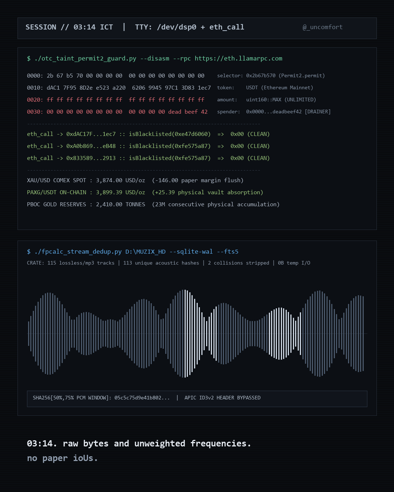
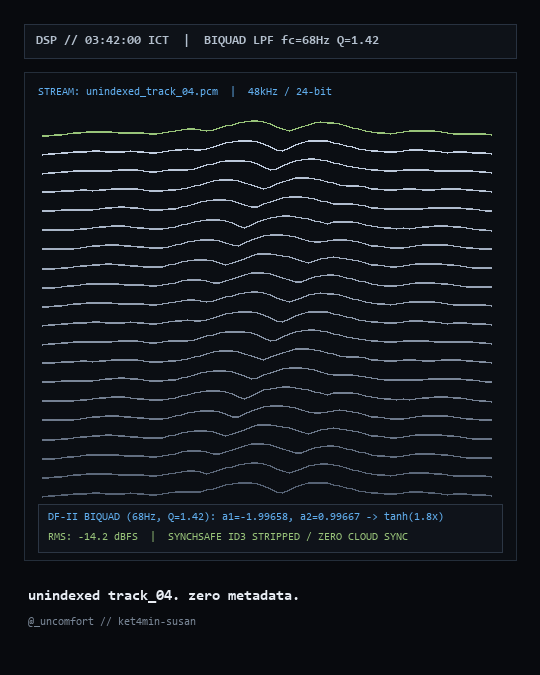

# `fpcalc-stream-dedup`

[](https://github.com/ket4min-susan/fpcalc-stream-dedup/actions/workflows/ci.yml)

Zero-disk Chromaprint (`fpcalc`) and mid-stream acoustic frame deduplicator with automated ID3 watermark stripping, backed by **SQLite WAL + FTS5**.

Built for crate-diggers and audio DSP engineers managing large lossless/mixset archives where identical recordings circulate under different filenames and polluted ID3v2 tags.





## Architecture

1. **Acoustic Fingerprinting (`Chromaprint` + Mid-Stream Frame Fallback):**
   - Uses `fpcalc -json -length 120` when present on PATH.
   - Falls back to sampling two 32 KB raw acoustic frame windows at `50%` and `75%` of file length, bypassing up to several hundred kilobytes of leading `ID3v2` `APIC` cover art and trailing `ID3v1` tags so identical recordings match regardless of metadata edits.
2. **SQLite WAL + Unicode61 FTS5 Index:**
   - Stores file paths, byte sizes, durations, SHA-256 fingerprint digests, and sanitized track titles in `audio_crates` + `audio_crates_fts`.
3. **Watermark Tag Sanitizer:**
   - Strips common promotional domain suffixes from track titles in a single pass.

## Usage

```bash
python fpcalc_stream_dedup.py /path/to/audio/crate
```
